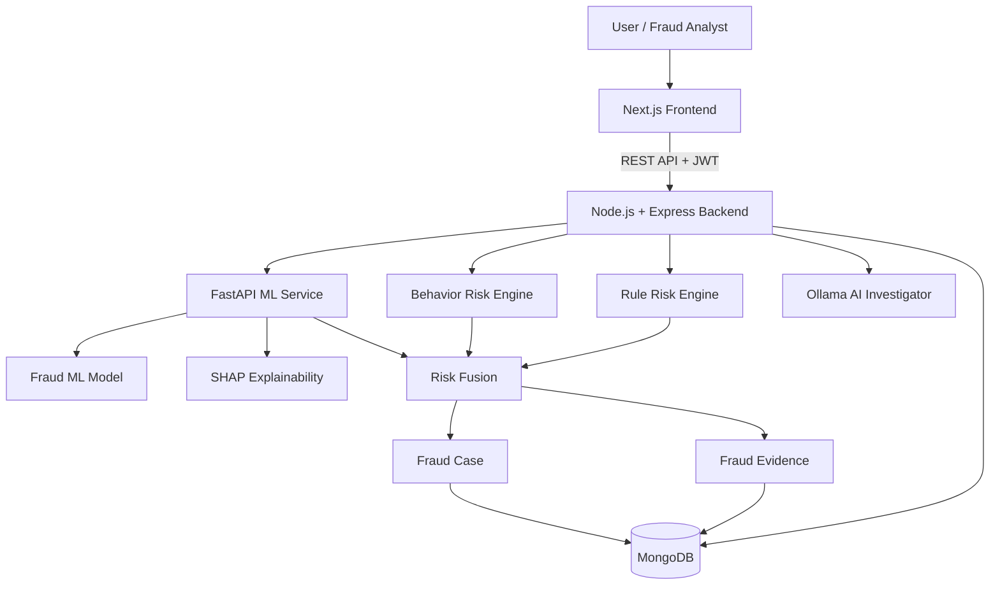
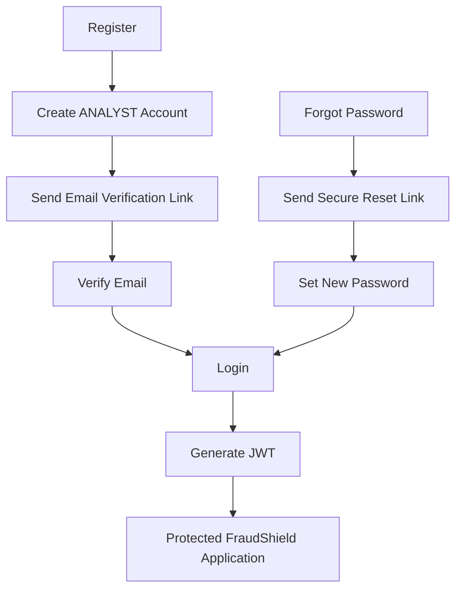

# 🛡️ FraudShield Intelligence

### Explainable AI Fraud Detection, Investigation & Evidence Platform

**FraudShield Intelligence** is an AI-assisted financial fraud detection and investigation platform designed to analyze transactions using multiple risk signals, generate explainable fraud evidence, create investigation cases, and assist analysts with local LLM-powered investigation reports.

The project combines **rule-based detection, behavioral analysis, machine learning, SHAP explanations, fraud case management, email-based authentication, JWT security, and an AI investigator** in one full-stack system.

> **Project Status:** Active Development  
> **Deployment:** Not deployed yet — currently designed to run locally.

---

## 🚀 Key Features

### 🔐 Authentication & Security

- Email + password registration
- Secure password hashing using `bcryptjs`
- Email verification using secure verification links
- JWT-based authentication
- Protected application pages and backend APIs
- Current-user profile support
- Logout
- Forgot-password flow
- Secure password-reset links
- User account status support
- User roles:
  - `ADMIN`
  - `ANALYST`
  - `INVESTIGATOR`

> New public registrations are assigned the `ANALYST` role by default.

### 💳 Transaction Analysis

FraudShield accepts financial transactions containing customer ID, amount, currency, merchant, device ID, IP address, location, transaction type, and transaction time.

### ⚙️ Rule-Based Risk Engine

Detects suspicious signals such as high transaction amount, unusual transaction time, missing device information, and missing IP address.

### 🧠 Behavioral Risk Engine

Analyzes customer history using signals such as historical transaction count, average amount, amount ratio, new device, new location, unusual hour, and recent transaction velocity.

### 🤖 Machine Learning Fraud Detection

The ML service is built with **Python + FastAPI + scikit-learn**. The project supports model experimentation with Logistic Regression, Random Forest, and XGBoost.

> The exact winning model depends on the latest training/evaluation result and is not hard-coded in this README.

### 🔎 Explainable AI with SHAP

FraudShield uses **SHAP** to explain ML predictions. The current ML feature set is based on transaction attributes such as transaction amount and transaction type.

> Device, location, and unusual-hour signals belong to the behavioral/rule engines and are **not presented as SHAP features**.

### 🧩 Risk Fusion Engine

```text
Rule Risk
   +
Behavior Risk
   +
ML Risk
   ↓
Final Fraud Risk
```

Risk levels:

```text
LOW
MEDIUM
HIGH
CRITICAL
```

### 📁 Fraud Case Management

Fraud cases include case ID, customer ID, linked transaction, linked risk assessment, risk score, severity, case status, evidence, assignment information, resolution information, and timestamps.

Supported statuses:

```text
OPEN
INVESTIGATING
ESCALATED
CONFIRMED_FRAUD
FALSE_POSITIVE
CLOSED
```

### 🧾 Unified Fraud Evidence Engine

Evidence may include:

- Rule evidence
- Behavioral evidence
- ML prediction
- ML probability
- ML risk score
- SHAP feature contributions

### 🕵️ AI Investigator

FraudShield includes an AI-assisted investigator powered by **Ollama**.

Current local model:

```text
qwen2.5:1.5b
```

The AI investigator can generate reports with:

```text
Summary
Risk Assessment
Key Evidence
Behavior Analysis
ML Analysis
Scenario Analysis
False Positive Considerations
Recommended Actions
Final Assessment
```

### 📊 Dashboard

Dashboard data includes:

- Total transactions
- Flagged transactions
- Flagged rate
- Total fraud cases
- Active cases
- Critical cases
- Confirmed fraud cases
- Average risk
- Risk distribution
- Transaction-status distribution
- Recent fraud cases
- Recent flagged transactions
- Transaction trends
- Risk trends

The frontend uses **Recharts** for graphical visualization.

---

# 🏗️ System Architecture



---

# 🧰 Technology Stack

## Frontend

- Next.js
- React
- TypeScript
- Tailwind CSS
- Recharts

## Backend

- Node.js
- Express.js
- TypeScript
- MongoDB
- Mongoose
- JWT
- bcryptjs
- Nodemailer
- Helmet
- CORS
- Morgan

## Machine Learning

- Python
- FastAPI
- scikit-learn
- Pandas
- NumPy
- XGBoost
- SHAP
- Joblib

## AI Investigator

- Ollama
- Qwen 2.5 local model

## Development Tools

- VS Code
- Postman
- Git
- GitHub
- MongoDB Compass

---

# 📂 Project Structure

```text
FraudShield-Intelligence/
│
├── frontend/
│   ├── src/
│   │   ├── app/
│   │   │   ├── dashboard/
│   │   │   ├── transactions/
│   │   │   ├── cases/
│   │   │   ├── investigations/
│   │   │   ├── analytics/
│   │   │   ├── login/
│   │   │   ├── register/
│   │   │   ├── verify-email/
│   │   │   ├── forgot-password/
│   │   │   └── reset-password/
│   │   ├── components/
│   │   ├── lib/
│   │   └── types/
│   └── .env.local
│
├── backend/
│   ├── src/
│   │   ├── modules/
│   │   │   ├── auth/
│   │   │   ├── users/
│   │   │   ├── transactions/
│   │   │   ├── risk/
│   │   │   ├── cases/
│   │   │   ├── dashboard/
│   │   │   └── ai/
│   │   ├── middleware/
│   │   └── app.ts
│   └── .env
│
├── ml-service/
│   ├── main.py
│   ├── train_model_v2.py
│   ├── explanation_utils.py
│   ├── models/
│   └── data/
│
└── README.md
```

---

# ⚙️ Local Setup

## Prerequisites

Install:

- Node.js 22+
- npm
- Python 3.x
- MongoDB
- Ollama
- Git

## 1. Clone Repository

```bash
git clone https://github.com/Sahil-Rathod-0306/FraudShield-Intelligence.git
cd FraudShield-Intelligence
```

# 🔧 Backend Setup

```bash
cd backend
npm install
```

Create:

```text
backend/.env
```

Example:

```env
PORT=5000
NODE_ENV=development

MONGODB_URI=mongodb://127.0.0.1:27017/fraudshield

FRONTEND_URL=http://localhost:3000

ML_SERVICE_URL=http://localhost:8000/predict

OLLAMA_BASE_URL=http://localhost:11434
OLLAMA_MODEL=qwen2.5:1.5b

JWT_SECRET=replace_with_your_secret
JWT_EXPIRES_IN=1d

SMTP_HOST=smtp.gmail.com
SMTP_PORT=587
SMTP_USER=your_email@gmail.com
SMTP_PASS=your_google_app_password

MAIL_FROM=FraudShield <your_email@gmail.com>

EMAIL_VERIFICATION_EXPIRES_MINUTES=30
PASSWORD_RESET_EXPIRES_MINUTES=30
```

Start backend:

```bash
npm run dev
```

Backend:

```text
http://localhost:5000
```

Health check:

```text
http://localhost:5000/api/health
```

# 🖥️ Frontend Setup

```bash
cd frontend
npm install
```

Create:

```text
frontend/.env.local
```

Add:

```env
NEXT_PUBLIC_API_URL=http://localhost:5000/api/v1
```

Start frontend:

```bash
npm run dev
```

Frontend:

```text
http://localhost:3000
```

# 🧠 ML Service Setup

```bash
cd ml-service
python -m venv venv
source venv/Scripts/activate
pip install -r requirements.txt
uvicorn main:app --reload --port 8000
```

ML service:

```text
http://localhost:8000
```

Docs:

```text
http://localhost:8000/docs
```

Health:

```text
http://localhost:8000/health
```

# 🤖 Ollama Setup

Check installed models:

```bash
ollama list
```

Pull model if required:

```bash
ollama pull qwen2.5:1.5b
```

Start Ollama:

```bash
ollama serve
```

Ollama:

```text
http://localhost:11434
```

If port `11434` is already in use, Ollama is probably already running.

# ▶️ Run Entire Platform

Use four terminals.

### Terminal 1 — Backend

```bash
cd backend
npm run dev
```

### Terminal 2 — ML Service

```bash
cd ml-service
source venv/Scripts/activate
uvicorn main:app --reload --port 8000
```

### Terminal 3 — Ollama

```bash
ollama serve
```

### Terminal 4 — Frontend

```bash
cd frontend
npm run dev
```

Then open:

```text
http://localhost:3000
```

---

# 🔐 Authentication Flow



---

# 🌐 Main API Routes

## Authentication

```text
POST /api/v1/auth/register
POST /api/v1/auth/verify-email
POST /api/v1/auth/resend-verification
POST /api/v1/auth/login
POST /api/v1/auth/forgot-password
POST /api/v1/auth/reset-password
GET  /api/v1/auth/me
```

## Transactions

```text
POST /api/v1/transactions
GET  /api/v1/transactions
GET  /api/v1/transactions/:transactionId
```

## Fraud Cases

```text
GET   /api/v1/cases
GET   /api/v1/cases/:caseId
PATCH /api/v1/cases/:caseId/status
PATCH /api/v1/cases/:caseId/assign
PATCH /api/v1/cases/:caseId/unassign
```

## AI Investigator

```text
GET  /api/v1/ai/health
POST /api/v1/ai/cases/:caseId/investigate
GET  /api/v1/ai/cases/:caseId/investigations
```

## Dashboard

```text
GET /api/v1/dashboard/overview
```

---

# 🧪 Example Suspicious Transaction

```json
{
  "customerId": "CUS-BEHAVIOR-001",
  "amount": 75000,
  "currency": "INR",
  "merchant": "Unknown Electronics",
  "deviceId": "DEVICE-UNKNOWN-99",
  "ipAddress": "49.50.70.10",
  "location": {
    "city": "Delhi",
    "country": "India"
  },
  "transactionType": "TRANSFER",
  "transactionTime": "2026-09-30T21:45:00.000Z"
}
```

Pipeline:

```text
Transaction
   ↓
Rule Analysis
   ↓
Behavior Analysis
   ↓
ML Prediction
   ↓
Risk Fusion
   ↓
Risk Assessment
   ↓
Fraud Evidence
   ↓
Fraud Case
   ↓
AI Investigation
```

# 📈 Example Risk Assessment

```text
Rule Risk:       40
Behavior Risk:   85
ML Risk:         78
Final Risk:      71
Risk Level:      HIGH
```

---

# 🔒 Security Practices

FraudShield currently includes:

- Password hashing with bcrypt
- JWT authentication
- Protected API routes
- Email verification
- Secure random verification tokens
- Hashed verification tokens in MongoDB
- Secure password-reset links
- Hashed password-reset tokens
- Generic password-reset responses to reduce account enumeration
- Helmet
- CORS
- Environment-variable based secrets
- Default `ANALYST` role for public registration

Never commit:

```text
.env
.env.local
SMTP passwords
JWT secrets
API keys
MongoDB credentials
Large private datasets
```

---

# 🚧 Current Limitations / Future Work

Planned improvements:

- Full RBAC permission enforcement for `ADMIN`, `ANALYST`, and `INVESTIGATOR`
- Admin user-management dashboard
- Investigator assignment workflow improvements
- Google authentication
- Neo4j fraud relationship graph
- Fraud network visualization
- Redis caching
- Kafka/event streaming
- FraudLab transaction attack simulator
- Transaction replay
- Additional ML experimentation
- Production deployment
- Production-grade HttpOnly cookie/session strategy
- Hosted ML inference
- Hosted AI investigator

---

# 🗺️ Roadmap

```text
✅ Transaction ingestion
✅ Rule-based fraud detection
✅ Behavioral fraud analysis
✅ ML fraud prediction
✅ Risk fusion
✅ Fraud case generation
✅ Unified fraud evidence
✅ SHAP explainability
✅ AI Investigator
✅ Transaction UI
✅ Fraud Cases UI
✅ Search / filters / pagination
✅ Dashboard analytics
✅ Email authentication
✅ Email verification
✅ JWT authentication
✅ Forgot / reset password

⬜ Google Sign-In
⬜ Full RBAC enforcement
⬜ Admin user management
⬜ Neo4j fraud graph
⬜ Fraud network UI
⬜ FraudLab simulator
⬜ Production deployment
```

---

# 🎯 Project Objective

FraudShield Intelligence demonstrates how modern fraud-detection systems can combine:

```text
Rules
+
Customer Behavior
+
Machine Learning
+
Explainable AI
+
Case Management
+
LLM-Assisted Investigation
```

The goal is to provide both **fraud risk detection** and **human-understandable evidence** for investigation.

---

# 👨‍💻 Author

**Sahil Rathod**

Computer / Information Technology Engineering Student  
Backend Developer | Full-Stack Developer | AI/ML Enthusiast

GitHub:

```text
https://github.com/Sahil-Rathod-0306
```

Project Repository:

```text
https://github.com/Sahil-Rathod-0306/FraudShield-Intelligence
```

---

## ⭐ Support

If you find this project useful, consider giving the repository a ⭐ on GitHub.

---

**FraudShield Intelligence — Detect. Explain. Investigate.**
